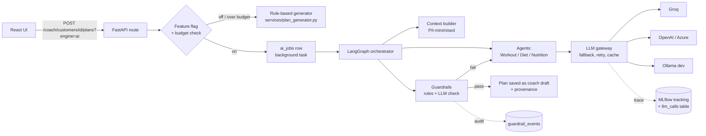
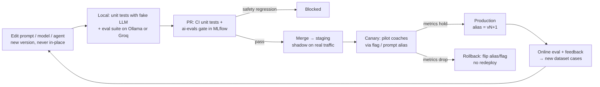

# AI Layer — Implementation Roadmap (LLMOps)

**Version:** 1.0 · **Date:** 2026-11-15 · **Status:** Active

This is the step-by-step plan for building the AI layer described in the [High-Level Design](HIGH_LEVEL_DESIGN.md) (section 6) and the [BRD](BUSINESS_REQUIREMENTS.md) (sections 7.3–7.8, 11). It expands [leftover_work.md section 8](../leftover_work.md#8-ai-layer) into an ordered sequence of steps.

**How to use it:** work through the steps in order. Each step has a **Definition of Done (DoD)**, so you know when it is finished. To start one, say *"Start step X.Y"*. Update the [progress tracker](#progress-tracker) as steps finish.

---

## Contents

1. [LLMOps principles](#1-llmops-principles-we-follow)
2. [Target architecture](#2-target-architecture)
3. [Metrics and SLOs](#3-metrics-and-slos)
4. [Phases and steps](#4-phases-and-steps)
5. [Change-promotion pipeline](#5-change-promotion-pipeline)
6. [Risk register](#6-ai-risk-register)
7. [Progress tracker](#progress-tracker)

---

## 1. LLMOps principles we follow

| # | Principle | What it means in this codebase |
|---|---|---|
| P1 | **Evaluate first** | Build the eval dataset and scorers *before* the first agent. No prompt or model change ships without an eval run. |
| P2 | **Deterministic where possible, LLM only where needed** | Calculators, calorie floors, macro arithmetic and injury exclusions stay in Python. The LLM chooses and explains; code computes and enforces. |
| P3 | **Everything versioned** | Prompts, model IDs, model parameters, eval datasets and output schemas are all versioned. Every generated plan records which versions produced it. |
| P4 | **Observable by default** | Every LLM call is traced: tokens, cost, latency, provider, prompt version, guardrail outcome. Traces link to the plan or chat message they produced. |
| P5 | **Human in the loop** | AI output is always a coach **draft** (BRD Q-4). Coach edits and approvals feed back as quality signals. |
| P6 | **Defence in depth for safety** | Input validation → rule-based guardrails → LLM guardrail → schema validation → coach review → customer disclaimer. Every intervention is audit-logged (FR-7.7). |
| P7 | **Graceful degradation** | Provider fallback chain, timeouts, circuit breaker, kill switch. If AI fails, the existing rule-based generator still works. |
| P8 | **Progressive delivery** | Feature flag → shadow mode → internal coaches → canary → general availability. Rollback is a config flip, not a redeploy. |
| P9 | **Cost is a metric** | Per-call cost recorded, per-user budgets enforced, alerts on spend. Target is under $0.10 per active user per month (HLD 14). |
| P10 | **Privacy by design** | Send only the minimum derived data to providers: no names, emails or free-text notes unless required. Explicit AI-processing consent. |
| P11 | **Continuous improvement loop** | Production traces, coach edits and thumbs-down are sampled into the eval dataset, so regressions are caught next time. |

Reference frameworks: **OWASP Top 10 for LLM Applications (2025)**, **NIST AI RMF (Govern / Map / Measure / Manage)**, **OpenTelemetry GenAI semantic conventions**, and **India DPDP Act 2023 / GDPR** for health data.

---

## 2. Target architecture

### 2.1 Request flow



### 2.2 Backend package layout (new)

```
backend/app/ai/
├── config.py            # AI settings view: providers, models, budgets, flags
├── gateway.py           # Chat-model factory, fallback chain, retries, timeouts, cache
├── tracing.py           # MLflow / LangSmith setup, trace-id helpers
├── cost.py              # Token → USD price table, budget checks
├── context.py           # Builds minimal, PII-free context from Customer + plans + progress
├── schemas/             # Pydantic output schemas (WorkoutPlanOut, DietPlanOut, GuardrailVerdict, ...)
├── prompts/             # Versioned prompt templates (YAML/Jinja) + registry.py
│   ├── workout_planner/v1.yaml
│   └── ...
├── agents/              # workout_planner.py, diet_planner.py, nutrition.py, guardrails.py, chat.py
├── graph/               # LangGraph state + orchestrator
├── guardrails/          # Deterministic checks shared by the AI and rule-based paths
└── evals/
    ├── datasets/        # JSONL golden sets (profiles, chat queries, adversarial)
    ├── scorers.py       # Deterministic + LLM-as-judge scorers
    └── run.py           # `python -m app.ai.evals.run --suite plans`
```

### 2.3 New database tables (Alembic migrations)

| Table | Purpose | Phase |
|---|---|---|
| `guardrail_events` | Every blocked or adjusted recommendation, from both the rule-based and AI paths (FR-7.7) | 1 |
| `llm_calls` | One row per LLM call: provider, model, prompt id+version, tokens in/out, cost, latency, status, fallback used, trace id, `customer_id` | 2 |
| `ai_jobs` | Async generation jobs: status, input hash, result plan id, error, timings | 8 |
| `ai_feedback` | Coach/customer ratings and edits linked to a plan or chat message | 6 |
| `chat_sessions`, `chat_messages` | Chat history (HLD 5.1, FR-6.5) | 10 |
| `workout_diet_plans` (columns) | `generator` (`rules`/`ai`), `generation_meta` JSONB (model, prompt versions, trace id, eval scores) | 6 |

---

## 3. Metrics and SLOs

These are defined up front (Step 0.3) and measured from the first agent onwards.

| Category | Metric | Target | Source |
|---|---|---|---|
| **Safety** | Injury-unsafe exercise in final plan | **0%** (BRD 11) | Deterministic scorer + `guardrail_events` |
| | Calorie target below floor or unsafe rate | **0%** shipped (BRD 11) | Deterministic scorer |
| | Guardrail catch rate on the adversarial set | ≥ 95% (HLD 14) | Eval suite |
| | Medical-diagnosis refusal (chat) | 100% on the refusal set | Eval suite |
| **Quality** | Schema-valid output on first attempt | ≥ 98% | `llm_calls` |
| | Indian-format diet for Indian users | 100% (BRD 11) | Deterministic scorer |
| | Diet restriction / allergen adherence | 100% (BG-2) | Deterministic scorer |
| | LLM-judge plan quality (rubric 1–5) | ≥ 4.0 average | Eval suite |
| | **Coach acceptance without major edits** | ≥ 70% at GA | `ai_feedback` + edit diff |
| | Customer plan approval rate | ≥ rule-based baseline | `workout_diet_plans.approved_at` |
| **Performance** | P95 plan generation latency | < 15 s (HLD 2.5) | Traces |
| | Chat time to first token | < 2 s P95 | Traces |
| **Reliability** | Plan generation success rate | > 98% (HLD 14) | `ai_jobs` |
| | Fallback-provider usage | < 10% (alert if higher) | `llm_calls` |
| **Cost** | Cost per active user per month | < $0.10 (BG-10) | `llm_calls` |
| | Cost per generated plan | Tracked; alert on +50% week over week | `llm_calls` |

---

## 4. Phases and steps

```mermaid
graph LR
    P0[0 Decisions<br/>& baseline] --> P1[1 Safety<br/>prerequisites] --> P2[2 AI<br/>foundation] --> P3[3 Observability] --> P4[4 Prompt<br/>management] --> P5[5 Eval<br/>harness] --> P6[6 Workout<br/>agent] --> P7[7 Diet +<br/>Nutrition] --> P8[8 Orchestrator<br/>+ guardrails] --> P9[9 Rollout &<br/>experiments]
    P9 --> P10[10 Chat<br/>assistant] --> P11[11 Adaptive<br/>review] --> P12[12 Continuous<br/>improvement] --> P13[13 Launch<br/>& showcase]
```



Phases 0–5 build the **platform** (no user-visible AI yet). Phase 6 is the first vertical slice. Every later feature reuses the same platform.

---

### Phase 0 — Decisions & baseline (mostly no code)

**Goal:** settle the choices that are expensive to change later, and measure today's rule-based system so AI can be compared against it.

| Step | What | Deliverable | DoD |
|---|---|---|---|
| **0.1** | **Architecture Decision Records (ADRs).** Decide and record: (a) LLM providers and models per agent tier (HLD 6.2); (b) orchestration framework (LangChain + LangGraph, per HLD); (c) tracking/tracing backend; (d) where MLflow is hosted; (e) sync vs async plan generation. | `docs/adr/0001-*.md` … | Each ADR has context, options, decision, consequences. |
| **0.2** | **Data privacy and consent review.** List exactly which customer fields may go to an LLM provider. Check each provider's data-retention and no-training terms; prefer zero-retention options. Add an "AI-assisted plans" consent line to the disclaimer. Settle BRD Q-2 (chat memory) and Q-3 (Hindi at launch). | `docs/AI_DATA_POLICY.md`, BRD section 12 updated | Field allow-list signed off; consent wording agreed. |
| **0.3** | **Define metrics and SLOs.** Adopt [section 3](#3-metrics-and-slos) and set the monthly LLM budget cap. | This document, section 3 | Targets agreed. |
| **0.4** | **Baseline the rule-based generator.** Run the current `generate_workout_plan` / `generate_diet_plan` over the 20 seeded/test profiles and record the deterministic scores (injury safety, restrictions, calorie accuracy). | `baseline_rules.json` in the eval datasets folder | Baseline numbers recorded; AI must match or beat them on safety. |
| **0.5** | **Provider accounts and secrets.** Create Groq and OpenAI (or Azure OpenAI) keys with **separate keys per environment** and hard spend limits in each provider dashboard. Install Ollama locally for offline development. | Keys in local `.env` and Render dashboard (never committed) | `.env.example` lists the variable names only. |

**Recommended defaults for 0.1** (fits the free-tier constraint, BRD section 9):

| Decision | Recommendation | Why |
|---|---|---|
| Strong tier (Workout, Diet) | Groq 70B-class Llama model; fallback OpenAI `gpt-4o-mini`-class or Azure equivalent | Fast, free tier; reliable paid fallback. Verify current model names when implementing. |
| Cheap tier (Nutrition, Guardrails judge) | Groq 8B-class model | Lowest latency and cost |
| Local / offline | Ollama (development and CI evals only) | Render's free tier cannot host Ollama (512 MB RAM) |
| Tracing and experiments | **MLflow 3** (GenAI tracing, prompt registry, `mlflow.genai.evaluate`) on a managed free tier such as Databricks Free Edition or DagsHub, plus **LangSmith in development only** | HLD 8.3. Self-hosting MLflow on the Render free instance is not viable: ephemeral disk, 512 MB RAM. |
| Plan generation mode | **Async job + polling** (`ai_jobs`) | Multi-agent runs can take 10–30 s; avoids proxy timeouts and supports retries. |

---

### Phase 1 — Safety prerequisites (from the non-AI backlog)

**Goal:** the AI guardrails are layered **on top of** deterministic guardrails (HLD 6.2), so those must exist first. These are the "Must" items in [leftover_work.md section 3](../leftover_work.md#3-safety--guardrails-rule-based) and part of section 7.

| Step | What | DoD |
|---|---|---|
| **1.1** | Run the backend test suite and the migration round trip ([leftover_work section 1](../leftover_work.md#1-verification)). | `pytest` green, `alembic check` clean. |
| **1.2** | Extract the deterministic guardrails into a reusable module (`app/ai/guardrails/rules.py` or `app/services/guardrails.py`): calorie floor, rate of change (≤ 1 kg/week loss, ≤ 0.5 kg/week gain), large-deficit warning (> 750 kcal), severity-aware injury exclusions, safe mode for chronic conditions (FR-7.5), allergen and diet-type checks. Each check returns a structured `GuardrailResult`. | The rule-based generator calls them; unit tests cover each rule. |
| **1.3** | `guardrail_events` table and migration, and a writer service. Log every block or adjustment, with source `rules` or `ai` (FR-7.7). | Events visible in the data export; tests assert events are written. |
| **1.4** | Disclaimer on every plan (FR-7.3) and a plan rationale field (FR-8.2–8.4), filled by rules for now. The AI fills the same field later. | The plan page shows "Why this plan?". |
| **1.5** | Structured logging (`structlog`) with a **correlation ID** middleware. The same ID is later attached to every LLM trace. | Logs are JSON; every request has an `x-request-id`. |
| **1.6** | Sentry for backend and frontend (free tier). | A test error shows up in Sentry with the correlation ID. |

---

### Phase 2 — AI foundation (platform, no agents yet)

**Goal:** one well-tested way to call an LLM, with fallback, structured output, privacy, cost accounting and a kill switch.

| Step | What | Details | DoD |
|---|---|---|---|
| **2.1** | **Dependencies and package skeleton** | Add `langchain-core`, `langgraph`, `langchain-groq`, `langchain-openai`, `langchain-ollama`, `mlflow`, `tenacity` to `requirements.txt` (pinned). Create the `app/ai/` layout from [2.2](#22-backend-package-layout-new). | `pip install` works; `pip-audit` clean; app starts. |
| **2.2** | **AI settings** | Extend [config.py](../backend/app/core/config.py): `AI_ENABLED`, `AI_ENGINE_DEFAULT` (`rules`/`ai`), provider keys (`SecretStr`), model ID per tier, timeouts, `AI_MONTHLY_BUDGET_USD`, `AI_USER_DAILY_TOKEN_LIMIT`, `MLFLOW_TRACKING_URI`, `LANGSMITH_*`. Production validator: if `AI_ENABLED`, at least one cloud provider key must be set, and LangSmith must be off. | Keys never appear in logs (test). |
| **2.3** | **LLM gateway** (`gateway.py`) | `get_chat_model(tier)` builds the Groq → OpenAI/Azure → Ollama chain with `.with_fallbacks()`, per-call timeout, retry with exponential backoff and jitter on 429/5xx only, and a simple circuit breaker per provider. Temperature is low (0–0.3) for planners. | Unit tests with a fake model: primary fails, fallback is used, and the fallback is recorded. |
| **2.4** | **Structured output contract** | Pydantic v2 output schemas in `app/ai/schemas/`. Use `.with_structured_output(Schema)` (JSON-schema / tool mode). Invalid output gets **one** repair retry, then fails cleanly; never `json.loads` on free text. | Schema round-trip tests; invalid output raises a typed error. |
| **2.5** | **Context builder and PII minimisation** | `context.py` turns a `Customer` into an `AIContext`: age band, sex, BMI/TDEE/targets from the existing calculators, goal, diet type, region, allergens, injuries (part, severity, status), equipment, days per week. **No** name, email, DOB, share code or free-text notes (notes only after sanitising, if 0.2 allows them). | Test asserts no PII keys or values reach the prompt. |
| **2.6** | **LLM call audit and cost** | `llm_calls` table and a LangChain callback handler that records provider, model, prompt id+version, tokens, cost (from the `cost.py` price table), latency, status, `trace_id`, `customer_id`, `request_id`. | Every fake-model call in tests writes one row. The table is excluded from the user export (operational data), or included if 0.2 decides so. |
| **2.7** | **Budgets and rate limits** | Per-user daily token cap and a global monthly cap, checked **before** each call. Stricter `slowapi` limits on AI endpoints (HLD 10.1). Over budget → fall back to the rule-based generator, with a clear message to the coach. | Tests for the budget-exceeded path. |
| **2.8** | **Kill switch and feature flags** | `AI_ENABLED` global switch, plus a per-coach allow-list (`AI_PILOT_COACH_IDS`) for the rollout in Phase 9. | Flipping the env var disables AI without a redeploy (Render env change + restart). |
| **2.9** | **Test doubles** | A `FakeChatModel` fixture in `tests/conftest.py` (LangChain `GenericFakeChatModel`) so **CI never calls real providers**. Real-provider tests are marked `@pytest.mark.llm` and skipped by default. | `pytest -q` passes offline. |
| **2.10** | **Response cache** | Exact-match cache keyed on `(prompt_version, model, hash(context))`, stored in Postgres or in memory with a TTL. A semantic cache is optional later. | Cache hit recorded in `llm_calls` with cost 0. |

---

### Phase 3 — Observability & tracing

**Goal:** see every AI request end to end before any user does.

| Step | What | DoD |
|---|---|---|
| **3.1** | **MLflow tracking server** set up per ADR 0.1. Experiments named `fitness-ai/{env}/{feature}`, for example `fitness-ai/prod/plan-generation`. | Dev and prod log to separate experiments. |
| **3.2** | **Tracing** in `tracing.py`: `mlflow.langchain.autolog()` (covers LangGraph). Add span attributes: `request_id`, `customer_id` (hashed), prompt versions, engine, guardrail result. LangSmith tracing only when `ENVIRONMENT=development`. | One plan generation gives one trace tree, linked from the `llm_calls` rows. |
| **3.3** | **Trace ↔ product linkage.** Store `trace_id` in `generation_meta` on the plan, so a coach complaint about a plan leads straight to its trace. | Admin script `python -m scripts.ai_trace <plan_id>` prints the trace link. |
| **3.4** | **Metrics and dashboards.** SQL views over `llm_calls`, `guardrail_events`, `ai_jobs`, `ai_feedback` for the [section 3](#3-metrics-and-slos) metrics. Start with a simple Metabase / Grafana Cloud free / Supabase SQL dashboard. | Dashboard shows latency P50/P95, cost per day, error and fallback rate, guardrail block rate. |
| **3.5** | **Alerts.** Sentry or Grafana alerts on: error rate > 5%, fallback rate > 10%, daily spend > 1/20 of the monthly cap, any `guardrail_events` with severity `critical`, P95 latency > 15 s. | Each alert is test-fired once. |

---

### Phase 4 — Prompt management

**Goal:** prompts are code: reviewed, versioned, tested and traceable.

| Step | What | DoD |
|---|---|---|
| **4.1** | **Prompt files.** `app/ai/prompts/<agent>/v<N>.yaml` with `id`, `version`, `model_tier`, `system`, `user_template` (Jinja2, strict undefined), `output_schema`, `changelog`. Never edit a released version; add a new file. | Loader validates every prompt at startup and in tests. |
| **4.2** | **Prompt registry.** `registry.py` resolves `agent → active version` from config, so a version can be switched by environment variable (rollback = flip). Optionally mirror releases to the MLflow Prompt Registry with aliases (`@production`, `@candidate`). | The active version is visible in `/ready` (non-secret) and in every trace. |
| **4.3** | **System prompt standards.** A shared safety preamble: role, "fitness guidance, not medical advice", refuse diagnosis, never go below the calorie floor, respect exclusions, output only the schema. User data is placed in clearly delimited blocks and treated as **data, not instructions** (prompt-injection defence, OWASP LLM01). | Reviewed against the OWASP LLM Top 10 checklist. |
| **4.4** | **Prompt change process.** A prompt change needs a PR, a changelog entry, an eval run (Phase 5) attached to the PR, and no safety regression. | Documented in `CONTRIBUTING` or this file, section 5. |

---

### Phase 5 — Evaluation harness (before the first agent)

**Goal:** a repeatable, automated answer to "is this prompt or model better, and is it safe?"

| Step | What | DoD |
|---|---|---|
| **5.1** | **Golden datasets** (JSONL, versioned in git): **plans_v1** with ≥ 20 profiles (BRD 11) covering every goal, diet type, region, injury severity, chronic condition, home/gym and experience level, plus edge cases (age 18 and 70, extreme BMI); **adversarial_v1** with prompt-injection strings in free-text fields, impossible goals and conflicting restrictions; **chat_v1** with 20 queries (BRD 11) including medical-diagnosis and Hindi queries. | Each record has `id`, `input`, `expectations`, `tags`. |
| **5.2** | **Deterministic scorers** (`scorers.py`), reusing the Phase 1 guardrail code: schema valid, injury-safe, calorie target within ±5% of the calculator, macros within tolerance, allergens absent, diet type respected, Indian meal format and portion units for Indian users, warm-up/cool-down present, rationale present. | 100% unit-tested; run against `baseline_rules.json`. |
| **5.3** | **LLM-as-judge scorers** with an explicit rubric (relevance to goal, progression logic, cultural fit, rationale clarity, tone), scored 1–5 with justification. Use a **different, stronger model** than the generator where possible. Calibrate: you (and ideally a real coach) hand-score 10 plans, and the judge must agree within ±1 on ≥ 80% of them. | Calibration results stored with the dataset. |
| **5.4** | **Eval runner.** `python -m app.ai.evals.run --suite plans --prompt workout_planner@v2 --model groq-70b` runs the suite, logs params, metrics and per-case artifacts to MLflow (`mlflow.genai.evaluate` or a custom loop), and prints a pass/fail table against thresholds. | A run is comparable side by side in the MLflow UI. |
| **5.5** | **CI gate.** A GitHub Actions job `ai-evals` that runs **only when `app/ai/**` changes**, with provider keys from GitHub secrets. Fails the PR on any safety-scorer regression, or a quality drop of more than 0.2. Nightly scheduled run against the production prompt versions to catch provider-side model drift. | A deliberately broken prompt fails CI. |

---

### Phase 6 — First vertical slice: Workout Planner agent

**Goal:** ship one agent end to end with the full LLMOps loop before building the others.

| Step | What | DoD |
|---|---|---|
| **6.1** | **Agent** `agents/workout_planner.py`: input `AIContext` plus the **allowed exercise list** (the injury-excluded set computed deterministically, P2). Output `WorkoutPlanOut`: split, sessions, exercises (chosen from the allowed list), sets, reps, rest, warm-up/cool-down, weekly progression, and a rationale per exercise group (FR-3.x, FR-8.2). | Passes all deterministic scorers on plans_v1; judge average ≥ 4.0. |
| **6.2** | **Post-generation guardrail.** Run the Phase 1 rules on the output. On a violation, either repair deterministically (drop the exercise) and log it, or regenerate once with the violation as feedback. | `guardrail_events` rows with `source=ai`. |
| **6.3** | **Provenance.** Migration adding `generator` and `generation_meta` to `workout_diet_plans`. The content shape stays compatible with the existing UI. | Old plans read as `generator=rules`. |
| **6.4** | **API and UI.** `POST /coach/customers/{id}/plans` accepts `engine: "rules" | "ai"` (default from the flag). The coach UI shows an "AI draft" badge, the rationale, and a **Regenerate with AI** button. The plan stays a draft until the coach sends it; the customer approval flow is unchanged. | Coach can compare AI and rule-based plans for the same customer. |
| **6.5** | **Feedback capture.** `ai_feedback` table: coach thumbs up/down with reason codes (unsafe, not relevant, too hard, too easy, other), plus an automatic **edit diff** between the AI draft and the version the coach approves (needs plan edit history from leftover_work section 5). | Coach acceptance rate visible on the dashboard. |
| **6.6** | **Transparency.** Customer-facing label "Created with AI assistance and reviewed by your coach" plus the disclaimer (FR-7.3). | Shown on the plan page. |

---

### Phase 7 — Food grounding, Diet Planner & Nutrition agents

**Prerequisite:** the Indian food database ([leftover_work section 4](../leftover_work.md#4-indian-food-adoption-brd-section-6)): IFCT 2017 ingredients, 200+ dishes, region tags, portion units.

| Step | What | DoD |
|---|---|---|
| **7.1** | **Food catalogue as the source of truth.** Every dish has an ID, nutrition per unit, region, diet tags and allergens. The LLM may only reference **catalogue IDs plus quantities**; **code computes macros** (anti-hallucination, HLD 13). | Unknown IDs are rejected by schema validation. |
| **7.2** | **Retrieval.** Pre-filter the catalogue deterministically (diet type, allergens, region, budget), then pass a shortlist to the LLM. Add embeddings (pgvector on Supabase) only if the shortlist grows too large for the context window. | Prompt size stays under the agreed token budget. |
| **7.3** | **Diet Planner agent**: a week of Indian-format meals (breakfast, lunch, evening snack with chai, dinner), regional variety, portion units (katori, roti), and a rationale per meal (FR-4.x, FR-8.3). | 100% Indian format and 100% restriction adherence on plans_v1. |
| **7.4** | **Nutrition agent**: only for dishes **not** in the catalogue (for example a coach's free-text swap). The cheap-tier model estimates macros, and the result is flagged "estimated" and capped by plausibility rules. | Estimates within ±20% of the reference on a 30-dish test set. |
| **7.5** | **Meal substitution** (FR-4.9): "Give me a Bengali version of lunch" via the existing meal-request flow; the coach approves. | End-to-end test through `/requests/meal`. |

---

### Phase 8 — LangGraph orchestrator, Guardrails agent & async jobs

| Step | What | DoD |
|---|---|---|
| **8.1** | **Graph** (`graph/plan_graph.py`) as in HLD 6.1: `validate_input → calculators → (workout ∥ diet) → nutrition → guardrails → finalize`, with a **bounded retry loop** (at most 2) that sends guardrail feedback back to the failing agent. Typed `PlanState` (Pydantic or TypedDict). | Graph unit-tested with fake models, covering pass, retry-then-pass and retry-exhausted paths. |
| **8.2** | **Guardrails agent**: deterministic rules first; then a cheap-model check for things rules can't see (unsafe wording, medical claims, inappropriate tone). Its verdict schema is `pass/fail + reasons`. Every intervention goes to `guardrail_events`. | ≥ 95% catch rate on adversarial_v1. |
| **8.3** | **Async jobs.** `ai_jobs` table; `POST` returns `202 {job_id}`; `GET /ai/jobs/{id}` to poll; the UI shows progress steps. Use FastAPI `BackgroundTasks` for the MVP, and a worker (for example ARQ + Redis) later if load requires. Jobs are idempotent per input hash. | Survives a provider timeout with a clean error and offers rule-based fallback. |
| **8.4** | **Load and latency check.** k6 or Locust over 20 concurrent generations against staging with real providers, within free-tier rate limits. | P95 < 15 s, success > 98%. |

---

### Phase 9 — Controlled rollout & experimentation

| Step | What | DoD |
|---|---|---|
| **9.1** | **Shadow mode.** For pilot coaches, the coach still receives the rule-based plan while the AI plan is generated in the background, scored and stored but not shown. Compare offline. | One week of shadow data with no safety failures. |
| **9.2** | **Internal pilot.** Enable AI drafts for the seeded/demo coaches and 1–2 friendly real coaches (`AI_PILOT_COACH_IDS`). Collect feedback in a weekly review. | Coach acceptance ≥ 60% and zero safety incidents. |
| **9.3** | **Canary / A/B.** Randomly assign coaches (sticky by coach ID) to `rules` or `ai`, or to prompt `vN` or `vN+1`. Compare acceptance, edit distance, customer approval, latency and cost in MLflow and the dashboards. | Decision documented with data. |
| **9.4** | **General availability** when the [section 3](#3-metrics-and-slos) targets hold for 2 consecutive weeks. The rule-based engine stays as the fallback and kill-switch path. | GA flag on; runbook published. |
| **9.5** | **Incident runbook.** Covers: provider outage, cost spike, unsafe-output report, prompt-injection report. Each says how to detect it, flip the switch, find the trace and communicate. | `docs/AI_RUNBOOK.md`. |

---

### Phase 10 — AI Chat Assistant

| Step | What | DoD |
|---|---|---|
| **10.1** | `chat_sessions` and `chat_messages` tables and migration; added to the data export and account deletion (GDPR). | Export and delete tests updated. |
| **10.2** | **Chat agent with tools, not context dumps**: `get_profile_summary`, `get_current_plan`, `get_recent_progress`, `search_exercise_library`, `search_food_catalogue`, and `create_coach_request` (plan changes go through the coach, FR-6.3). Tools are **read-only** except `create_coach_request` (OWASP LLM06: excessive agency). | Tool calls traced; authorization re-checked inside every tool. |
| **10.3** | **Safety layer**: input moderation and injection heuristics, the medical-diagnosis refusal policy (FR-6.4), output check, and a disclaimer footer where relevant. | 100% refusal on the medical set and ≥ 95% on the injection set. |
| **10.4** | **Endpoint** `POST /chat/message` with **SSE streaming**, a strict rate limit and a per-user token budget. Conversation memory follows the Q-2 decision, using a summary buffer for long chats. | TTFT < 2 s P95. |
| **10.5** | **Wire up `ChatPage.tsx`**: streaming, suggestion chips, thumbs up/down per message into `ai_feedback`, "AI can make mistakes" notice. | Playwright test for a full chat round trip. |
| **10.6** | **Hindi** (FR-6.6), if chosen in 0.2: language detection, reply in the user's language, and Hindi cases in chat_v1. | Hindi eval subset passes. |

---

### Phase 11 — Adaptive weekly review (AI)

| Step | What | DoD |
|---|---|---|
| **11.1** | Extend `services/weekly_review.py`: the **deterministic** calorie suggestion stays authoritative. The AI adds a natural-language summary, progression suggestions from logged sets and reps (FR-5.8, needs the logging in leftover_work section 6) and motivational notes. | AI output never changes the numeric adjustment; there is a test for this. |
| **11.2** | Coach applies or dismisses as today; the apply/dismiss rate is tracked as the quality signal. | Visible on the dashboard. |

---

### Phase 12 — Production monitoring & continuous improvement

| Step | What | Cadence |
|---|---|---|
| **12.1** | **Online evaluation**: sample 5–10% of production traces and run the deterministic scorers and the LLM judge asynchronously; chart the scores over time. | Continuous |
| **12.2** | **Feedback → dataset loop**: every thumbs-down, guardrail block and heavily edited plan is reviewed, anonymised and added to the golden datasets (`plans_v2`, …). | Weekly |
| **12.3** | **Drift and model-upgrade playbook**: when a provider updates or deprecates a model, run the full eval suite on the candidate, shadow it, then promote it with a config change. Pin model versions where providers allow. | On each provider change |
| **12.4** | **Cost review**: cost per user, cache hit rate, prompt token trimming, moving steps to the cheaper tier. | Monthly |
| **12.5** | **Red-team exercise** against the OWASP LLM Top 10: injection via profile notes and chat, system-prompt leakage, data exfiltration through tools, unbounded consumption. | Before GA, then quarterly |
| **12.6** | **Retention and privacy**: purge prompt/response payloads from traces after N days (keep the metrics), honour account deletion in `llm_calls` and the traces. | Scheduled job |

---

### Phase 13 — Launch readiness & showcase

These are the items that make the live product credible and get it noticed.

| Step | What |
|---|---|
| **13.1** | **Model card / AI transparency page** (public): which models are used, what data is sent, safety measures, human-in-the-loop design, known limitations. |
| **13.2** | **Public evaluation report**: safety and quality scores on the golden datasets, with methodology (anonymised). Update it on each major release. |
| **13.3** | **Architecture write-up**: multi-agent graph, guardrails, LLMOps pipeline, cost per user. Use it for a README section, a blog post or LinkedIn, and a portfolio piece. |
| **13.4** | **Demo assets**: a 2-minute video of a coach generating an AI plan, the guardrail catching an unsafe request, and the trace view; seeded demo accounts with AI enabled. |
| **13.5** | **Update docs**: README "What's built", [HLD](HIGH_LEVEL_DESIGN.md) (actual hosting choices), [BRD section 14](BUSINESS_REQUIREMENTS.md#14-implementation-status), [leftover_work.md](../leftover_work.md). |

---

## 5. Change-promotion pipeline

Every change to a prompt, model, agent or graph follows the same path:



**Environments**

| Environment | LLM providers | Tracking | Data |
|---|---|---|---|
| Local dev | Ollama or Groq dev key | Local MLflow + LangSmith | Seed data |
| CI | Fake model (unit tests); Groq CI key (eval job only) | MLflow `ci` experiment | Golden datasets |
| Staging *(optional on free tier: a second Render service)* | Groq / OpenAI staging keys | MLflow `staging` | Seed data |
| Production | Groq → OpenAI/Azure fallback | MLflow `prod` | Real, PII-minimised |

---

## 6. AI risk register

| Risk (OWASP LLM 2025) | Mitigation step(s) |
|---|---|
| LLM01 Prompt injection (profile notes, chat) | 2.5, 4.3, 10.3, 12.5 |
| LLM02 Sensitive information disclosure | 0.2, 2.5, 12.6 |
| LLM03 Supply chain (packages, models) | 2.1 pinned + `pip-audit`, 12.3 |
| LLM05 Improper output handling | 2.4 schemas, 7.1 catalogue IDs, 8.2 |
| LLM06 Excessive agency | 10.2 read-only tools, coach approval (P5) |
| LLM07 System prompt leakage | 4.3 no secrets in prompts, 12.5 |
| LLM09 Misinformation (nutrition, exercise) | 7.1 grounding, 5.2 scorers, coach review |
| LLM10 Unbounded consumption | 2.7 budgets, 3.5 alerts |
| Provider outage or free-tier limits | 2.3 fallback, 2.8 kill switch, rule-based fallback |
| Unsafe health advice | Phase 1 rules, 8.2, 6.6 disclaimer, coach approval |

---

## Progress tracker

| Phase | Step | Title | Status |
|---|---|---|---|
| 0 | 0.1 | ADRs (providers, framework, tracking, hosting, async) | ☐ |
| 0 | 0.2 | Data privacy and consent review | ☐ |
| 0 | 0.3 | Metrics and SLOs agreed | ☐ |
| 0 | 0.4 | Rule-based baseline measured | ☐ |
| 0 | 0.5 | Provider accounts, keys and spend limits | ☐ |
| 1 | 1.1 | Tests and migrations verified | ☐ |
| 1 | 1.2 | Deterministic guardrails module | ☐ |
| 1 | 1.3 | `guardrail_events` audit log | ☐ |
| 1 | 1.4 | Disclaimer and rationale on every plan | ☐ |
| 1 | 1.5 | Structured logging and correlation IDs | ☐ |
| 1 | 1.6 | Sentry | ☐ |
| 2 | 2.1 | Dependencies and `app/ai` skeleton | ☐ |
| 2 | 2.2 | AI settings | ☐ |
| 2 | 2.3 | LLM gateway with fallback | ☐ |
| 2 | 2.4 | Structured output contract | ☐ |
| 2 | 2.5 | Context builder and PII minimisation | ☐ |
| 2 | 2.6 | `llm_calls` audit and cost | ☐ |
| 2 | 2.7 | Budgets and rate limits | ☐ |
| 2 | 2.8 | Kill switch and feature flags | ☐ |
| 2 | 2.9 | Fake-LLM test doubles | ☐ |
| 2 | 2.10 | Response cache | ☐ |
| 3 | 3.1 | MLflow tracking server | ☐ |
| 3 | 3.2 | Tracing | ☐ |
| 3 | 3.3 | Trace ↔ plan linkage | ☐ |
| 3 | 3.4 | Dashboards | ☐ |
| 3 | 3.5 | Alerts | ☐ |
| 4 | 4.1 | Prompt files | ☐ |
| 4 | 4.2 | Prompt registry | ☐ |
| 4 | 4.3 | System prompt standards | ☐ |
| 4 | 4.4 | Prompt change process | ☐ |
| 5 | 5.1 | Golden datasets | ☐ |
| 5 | 5.2 | Deterministic scorers | ☐ |
| 5 | 5.3 | LLM-as-judge with calibration | ☐ |
| 5 | 5.4 | Eval runner | ☐ |
| 5 | 5.5 | CI eval gate | ☐ |
| 6 | 6.1–6.6 | Workout Planner agent (vertical slice) | ☐ |
| 7 | 7.1–7.5 | Food grounding, Diet and Nutrition agents | ☐ |
| 8 | 8.1–8.4 | LangGraph orchestrator, Guardrails agent, async jobs | ☐ |
| 9 | 9.1–9.5 | Shadow, pilot, canary, GA, runbook | ☐ |
| 10 | 10.1–10.6 | Chat assistant | ☐ |
| 11 | 11.1–11.2 | Adaptive weekly review | ☐ |
| 12 | 12.1–12.6 | Continuous improvement | ☐ |
| 13 | 13.1–13.5 | Launch and showcase | ☐ |
